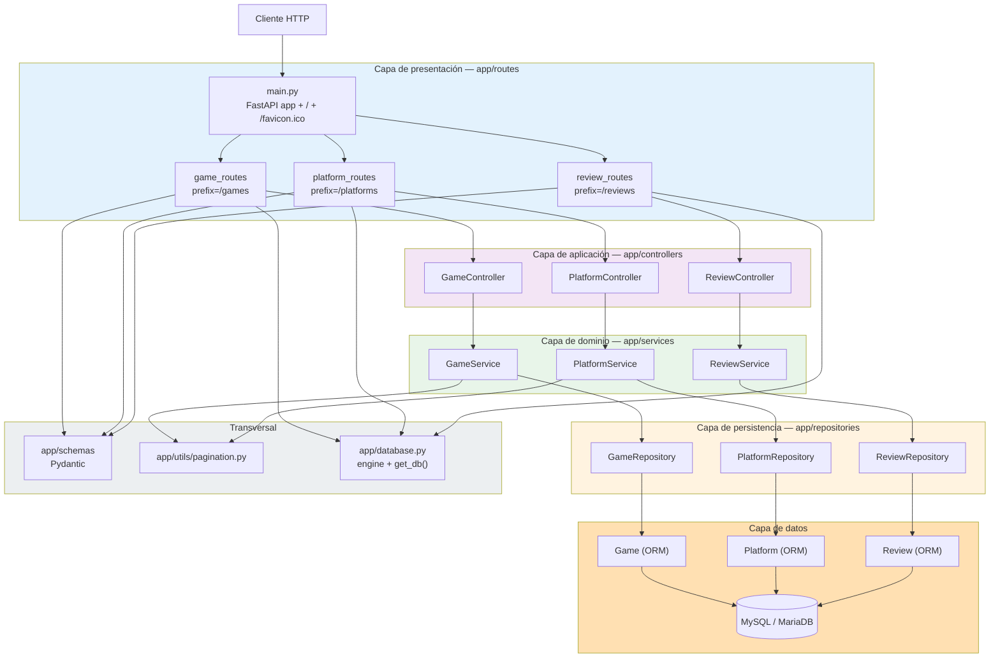
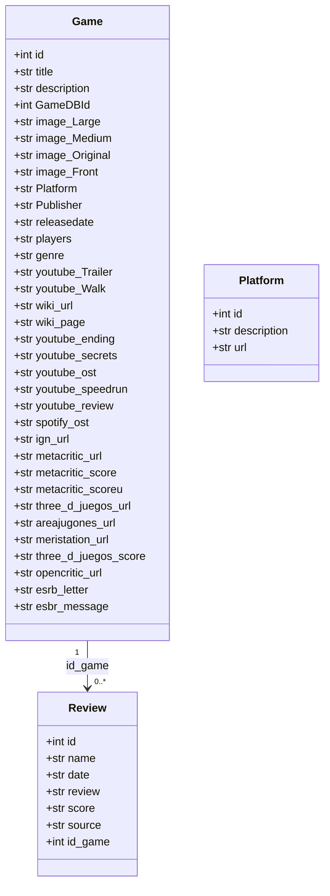
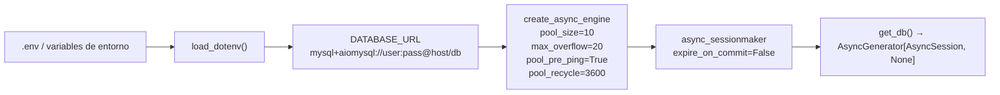
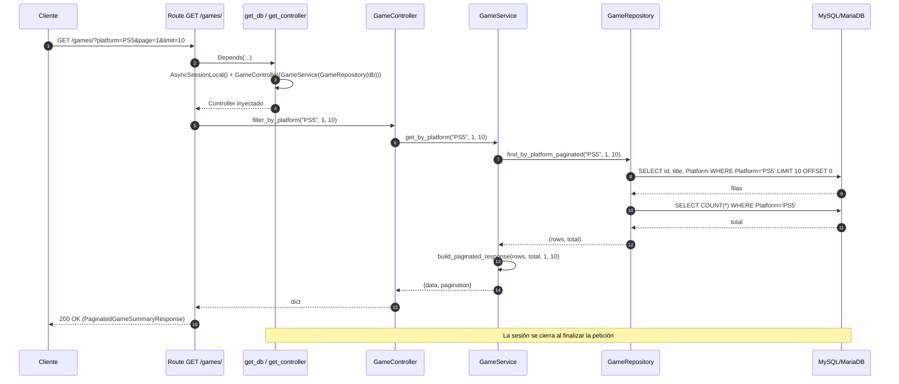
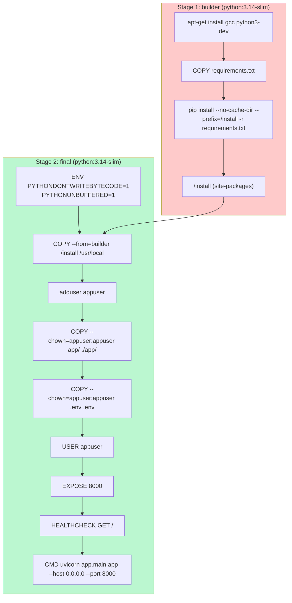
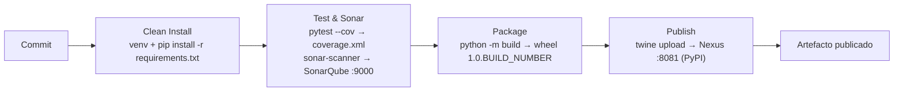
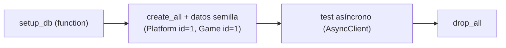

# Especificación de Diseño de Software (SDD)

## Games API — `backend-python`

| Campo                 | Valor                                              |
| --------------------- | -------------------------------------------------- |
| Proyecto              | `backend-python`                                   |
| Producto              | Games API                                          |
| Versión del producto  | 1.0.0                                              |
| Versión del documento | 1.0                                                |
| Fecha                 | 6 de octubre de 2026                               |
| Documento relacionado | `REQUERIMIENTOS.md` (SRS)            |

> **Propósito:** describir **cómo** está construido el sistema (estructura, componentes,
> interacciones, algoritmos y decisiones de diseño), complementando la especificación de
> **qué** debe hacer (`REQUERIMIENTOS.md`).
>
> **Fuente de verdad:** el contenido se derivó directamente del código en su estado actual
> (`app/`, `tests/`, `Dockerfile`, `Jenkinsfile`). Ante cualquier discrepancia, prevalece el
> código.

---

## 1. Introducción

### 1.1 Alcance

El diseño cubre: arquitectura de capas, diseño detallado de cada capa, modelo de datos lógico
y físico, diseño de la paginación, contratos de interfaz, empaquetado/despliegue, diseño de
pruebas y las decisiones de diseño con su justificación.

### 1.2 Referencias

- `REQUERIMIENTOS.md` — requisitos funcionales y no funcionales.
- `DEEPSEEK.md` — convenciones del repositorio.
- `DIAGRAMAS_VISUALES.md` — diagramas consolidados previos.
- `README.md` — ejemplos de uso reales.

### 1.3 Definiciones

| Término          | Definición                                                                |
| ---------------- | ------------------------------------------------------------------------- |
| Capa             | Conjunto de módulos con una responsabilidad única en la arquitectura       |
| DTO / Schema     | Modelo Pydantic de entrada o salida                                        |
| Factory          | Función que construye el grafo de dependencias de una petición              |
| Column pruning   | Reducir las columnas seleccionadas en una consulta                         |
| Row              | Tupla de SQLAlchemy resultante de una proyección de columnas               |

---

## 2. Diseño arquitectónico

### 2.1 Estilo arquitectónico

El sistema usa una **arquitectura en capas estricta** con dependencias dirigidas **hacia
abajo** y **flujo unidireccional**. Cada capa conoce únicamente a la inmediatamente inferior:

```
┌──────────────────────────────────────────────────────────────┐
│  Capa de presentación      Routes (FastAPI APIRouter)        │
├──────────────────────────────────────────────────────────────┤
│  Capa de aplicación        Controllers (orquestación, HTTP)  │
├──────────────────────────────────────────────────────────────┤
│  Capa de dominio           Services (lógica de negocio)      │
├──────────────────────────────────────────────────────────────┤
│  Capa de persistencia      Repositories (SQLAlchemy Async)   │
├──────────────────────────────────────────────────────────────┤
│  Capa de datos             Models (ORM) + MySQL/MariaDB      │
└──────────────────────────────────────────────────────────────┘
        ▲                                     ▲
        │  Schemas (Pydantic)  ────────────────┘
        │  contratos de entrada/salida (transversal)
```

**Regla de dependencia:** un módulo solo puede importar de su propia capa o de capas
inferiores. El acceso a la base de datos está **exclusivamente** en `app/repositories/`.

### 2.2 Vista de componentes



### 2.3 Principios y patrones aplicados

| Patrón                      | Dónde se aplica                                        | Propósito                                                |
| --------------------------- | ------------------------------------------------------ | -------------------------------------------------------- |
| **Layered Architecture**    | Todo el proyecto                                       | Separación de responsabilidades                          |
| **Repository Pattern**      | `app/repositories/`                                    | Aislar el SQL de la lógica de negocio                    |
| **Service Layer**           | `app/services/`                                        | Concentrar reglas de negocio y formateo                  |
| **Dependency Injection**    | `Depends(get_db)`, `Depends(get_controller)`           | Inversión de control y testeabilidad                     |
| **Factory / Composition Root** | `get_controller()` en cada módulo de rutas          | Construir el grafo `Repository → Service → Controller`   |
| **DTO / Schema Validation** | `app/schemas/` con Pydantic v2                         | Contratos tipados de entrada/salida                      |
| **Async/Await**             | Todas las capas                                        | No bloquear el event loop                                |
| **Column Pruning**          | `find_by_platform_paginated`                           | Reducir el volumen de datos transferidos                 |

### 2.4 Flujo general de una petición

1. El cliente envía una petición HTTP.
2. FastAPI resuelve las dependencias: `get_db()` abre una `AsyncSession` y `get_controller()`
   construye `Controller(Service(Repository(session)))`.
3. El **Controller** orquesta: delega en el servicio y aplica validaciones HTTP
   (`HTTPException` 400/404).
4. El **Service** ejecuta la lógica de negocio (paginación, filtros) y formatea el resultado.
5. El **Repository** emite las consultas SQLAlchemy asíncronas y devuelve filas.
6. FastAPI serializa con el `response_model` Pydantic y cierra la sesión al finalizar la
   petición.

---

## 3. Diseño detallado por capa

### 3.1 Capa de presentación — `app/routes/`

Cada módulo define un `APIRouter` con `prefix` y `tags`, y una *factory* de dependencias:

```python
def get_controller(db: Annotated[AsyncSession, Depends(get_db)]) -> GameController:
    return GameController(GameService(GameRepository(db)))

ControllerDep = Annotated[GameController, Depends(get_controller)]
```

| Módulo                | Prefijo      | Tag         | Endpoints definidos                                             |
| --------------------- | ------------ | ----------- | --------------------------------------------------------------- |
| `game_routes.py`      | `/games`     | `Games`     | `GET /search`, `GET /`, `GET /{id}`, `POST /`, `PUT /{id}`, `DELETE /{id}` |
| `platform_routes.py`  | `/platforms` | `Platforms` | `GET /`, `GET /{id}`, `POST /`, `PUT /{id}`, `DELETE /{id}`      |
| `review_routes.py`    | `/reviews`   | `Reviews`   | `GET /{id}`                                                      |
| `main.py`             | —            | `Root`      | `GET /`, `GET /favicon.ico`                                      |

**Decisiones de diseño:**

- Los parámetros de paginación se declaran con `Annotated[int, Query(ge=0)]` (page) y
  `Query(ge=1)` (limit), trasladando la validación de rango a FastAPI (`422`).
- El orden de declaración importa: `GET /search` se declara **antes** de `GET /{id}` para que
  la ruta literal no sea capturada por el parámetro de path.
- Los `response_model` fijan el contrato de salida y filtran campos no deseados.

### 3.2 Capa de aplicación — `app/controllers/`

Responsabilidad única: **orquestar** el servicio y **traducir** el resultado a HTTP. No
contienen SQL ni reglas de negocio.

| Clase                | Método                                        | Comportamiento                                              |
| -------------------- | --------------------------------------------- | ----------------------------------------------------------- |
| `GameController`     | `get_all_games()`                             | Delega en `service.get_all()`                               |
| `GameController`     | `get_game_by_id(id)`                          | `404 "Juego no encontrado"` si no existe                     |
| `GameController`     | `search_by_title(title, page, limit)`         | `400 "El parámetro 'title' es requerido"` si `title` vacío    |
| `GameController`     | `filter_by_platform(platform, page, limit)`   | Delega la paginación al servicio                             |
| `PlatformController` | `get_all_platforms()`                         | Delega en `service.get_all()`                                |
| `PlatformController` | `get_all_platforms_paginated(page, limit)`    | Delega la paginación al servicio                             |
| `PlatformController` | `get_platform_by_id(id)`                      | `404 "Plataforma no encontrada"` si no existe                |
| `ReviewController`   | `get_reviews(game_id)`                        | `404 "Reseñas no encontradas para este juego"` si la lista está vacía |

> **Desviación conocida:** los controladores **no implementan** los métodos de escritura
> (`create_*`, `update_*`, `delete_*`) que sí invocan las rutas. Ver §9.

### 3.3 Capa de dominio — `app/services/`

Contiene la lógica de negocio y el **formateo de respuestas**. Es la única capa que conoce la
estructura `{data, pagination}`.

| Clase             | Método                                        | Responsabilidad                                        |
| ----------------- | --------------------------------------------- | ------------------------------------------------------ |
| `GameService`     | `get_all()`                                   | Devuelve todas las entidades                           |
| `GameService`     | `get_by_id(id)`                               | Devuelve una entidad o `None`                          |
| `GameService`     | `get_by_title(title, page, limit)`            | Delega y formatea la búsqueda por prefijo              |
| `GameService`     | `get_by_platform(platform, page, limit)`      | Delega y formatea el filtro por plataforma             |
| `PlatformService` | `get_all()`                                   | Devuelve plataformas con `url` no nulo                 |
| `PlatformService` | `get_all_paginated(page, limit)`              | Delega y formatea el listado paginado                  |
| `PlatformService` | `get_by_id(id)`                               | Devuelve una entidad o `None`                          |
| `ReviewService`   | `get_reviews_by_game(game_id)`                | Devuelve las reseñas del juego                         |

**Contrato interno de paginación:** los métodos paginados devuelven
`dict[str, Any]` con la forma `{"data": [...], "pagination": {...}}`, construida por
`build_paginated_response`.

### 3.4 Capa de persistencia — `app/repositories/`

Única capa con acceso a la base de datos. Todas las operaciones son `async` y hacen `commit`
cuando mutan datos.

| Repositorio           | Método                                            | Consulta / operación                                                                 |
| --------------------- | ------------------------------------------------- | ------------------------------------------------------------------------------------ |
| `GameRepository`      | `find_all()`                                      | `SELECT * FROM games`                                                                 |
| `GameRepository`      | `find_by_id(id)`                                  | `SELECT ... WHERE id = :id` → `scalar_one_or_none()`                                  |
| `GameRepository`      | `create(data)`                                    | `Game(**data)`, `add`, `commit` (la PK se rellena con el flush)                        |
| `GameRepository`      | `update(id, data)`                                | `UPDATE games SET ... WHERE id = :id`, `commit`                                        |
| `GameRepository`      | `delete(id)`                                      | `DELETE FROM games WHERE id = :id`, `commit`                                           |
| `GameRepository`      | `find_by_title_paginated(title, page, limit)`     | `WHERE title LIKE 'texto%'` + `LIMIT/OFFSET` + `COUNT(*)`                              |
| `GameRepository`      | `find_by_platform_paginated(platform, page, limit)` | Proyección `(id, title, Platform)` + `LIMIT/OFFSET` + `COUNT(*)`                     |
| `PlatformRepository`  | `find_all()`                                      | `SELECT ... WHERE url IS NOT NULL`                                                     |
| `PlatformRepository`  | `find_all_paginated(page, limit)`                 | `WHERE url IS NOT NULL` + `LIMIT/OFFSET` + `COUNT(*)`                                  |
| `PlatformRepository`  | `find_by_id(id)` / `create` / `update` / `delete` | Igual que `GameRepository`                                                             |
| `ReviewRepository`    | `find_by_game_id(game_id)`                        | `SELECT ... WHERE id_game = :game_id`                                                  |

**Decisiones de rendimiento adoptadas:**

| Decisión                                    | Justificación                                                              |
| ------------------------------------------- | -------------------------------------------------------------------------- |
| `select(func.count()).select_from(Model)`   | `COUNT(*)` evita evaluar la columna; `select_from` fija la tabla del conteo  |
| Sin `refresh()` tras `commit()`             | El `commit` ya hace *flush* y rellena la PK; `refresh` sería un `SELECT` extra |
| `offset = max(page - 1, 0) * limit`         | Impide `OFFSET` negativos con `page <= 0`                                    |
| Proyección de columnas en `find_by_platform_paginated` | Evita transferir columnas `Text` pesadas que no se exponen        |
| `pool_pre_ping=True` + `pool_recycle=3600`  | Descarta conexiones muertas antes del `wait_timeout` del servidor            |

### 3.5 Capa de datos — `app/models/`

Mapeo ORM declarativo sobre `Base` (`declarative_base()` de `app/database.py`). Sin
`relationship`; la única relación es la FK a nivel de base de datos.



**Detalles de mapeo:**

- `three_d_juegos_url` / `three_d_juegos_score` se mapean a las columnas `3djuegos_url` /
  `3djuegos_score` porque un identificador Python no puede empezar por dígito.
- `Game.title` y `Game.Platform` están **indexados** (`index=True`) por ser campos de filtro.
- `Review.id_game` usa `ForeignKey(..., ondelete="SET NULL", onupdate="CASCADE")`.

### 3.6 Transversal — `app/schemas/`

| Módulo              | Clases                                                                        |
| ------------------- | ----------------------------------------------------------------------------- |
| `game_schema.py`    | `GameBase`, `GameCreate`, `GameResponse`, `GameSummary`, `PaginatedGameResponse`, `PaginatedGameSummaryResponse` |
| `platform_schema.py`| `PlatformBase`, `PlatformCreate`, `PlatformResponse`, `PaginatedPlatformResponse` |
| `review_schema.py`  | `ReviewBase`, `ReviewResponse`                                                 |
| `pagination.py`     | `PaginationInfo` (compartido)                                                  |

**Decisiones de diseño:**

- **Pydantic v2:** `model_config = ConfigDict(...)` en lugar del `class Config` deprecado.
- **Serialización ORM:** `from_attributes=True` en los schemas de respuesta.
- **Alias:** `populate_by_name=True` en `GameBase` para aceptar `3djuegos_url` como alias de
  `three_d_juegos_url`.
- **Renombrado de campo:** `GameSummary.platform` usa `validation_alias="Platform"` para
  exponer en JSON `platform` mientras el atributo ORM es `Platform`.
- **Reutilización:** `PaginationInfo` se extrajo a un módulo propio para evitar duplicarlo en
  los schemas de juegos y plataformas.

### 3.7 Utilidades — `app/utils/pagination.py`

`build_paginated_response(rows, total, page, limit)` centraliza la construcción del sobre de
paginación (antes duplicada en los servicios):

```python
total_pages = (total + limit - 1) // limit if total > 0 else 0
return {
    "data": rows,
    "pagination": {
        "currentPage": page,
        "perPage": limit,
        "totalRecords": total,
        "totalPages": total_pages,
    },
}
```

- Aritmética **entera** en lugar de `math.ceil` (evita punto flotante).
- `currentPage` refleja el valor solicitado sin normalizar.
- `totalPages = 0` cuando no hay registros.

### 3.8 Configuración y sesiones — `app/database.py`



- `async_sessionmaker` (API moderna de SQLAlchemy 2.x).
- `get_db()` usa `async with`, garantizando el cierre de la sesión al finalizar la petición.
- Defaults: `DB_USER=admin`, `DB_PASSWORD=password`, `DB_HOST=192.168.1.82`, `DB_NAME=game`.

---

## 4. Diseño de datos

### 4.1 Modelo lógico

```mermaid
erDiagram
    GAMES ||--o{ REVIEW : "id_game"

    GAMES {
        int id PK "autoincrement"
        string title "NOT NULL, indexado"
        text description "NOT NULL"
        int GameDBId "NULL"
        string image_Large "NULL"
        string image_Medium "NULL"
        string image_Original "NULL"
        string image_Front "NULL"
        string Platform "NULL, indexado"
        string Publisher "NULL"
        string releasedate "NULL"
        string players "NULL"
        string genre "NULL"
        string youtube_Trailer "NULL"
        string youtube_Walk "NULL"
        string wiki_url "NULL"
        text wiki_page "NULL"
        string youtube_ending "NULL"
        string youtube_secrets "NULL"
        string youtube_ost "NULL"
        string youtube_speedrun "NULL"
        string youtube_review "NULL"
        string spotify_ost "NULL"
        string ign_url "NULL"
        string metacritic_url "NULL"
        string metacritic_score "NULL"
        string metacritic_scoreu "NULL"
        string "3djuegos_url" "NULL"
        string areajugones_url "NULL"
        string meristation_url "NULL"
        string "3djuegos_score" "NULL"
        string opencritic_url "NULL"
        string esrb_letter "NULL"
        string esbr_message "NULL"
    }

    PLATFORM {
        int id PK "autoincrement"
        string description "NOT NULL"
        string url "NULL"
    }

    REVIEW {
        int id PK "autoincrement"
        string name "NULL"
        string date "NULL"
        text review "NOT NULL"
        string score "NULL"
        string source "NOT NULL"
        int id_game FK "NULL, ON DELETE SET NULL"
    }
```

### 4.2 Modelo físico (MySQL/MariaDB)

| Tabla      | Longitudes destacadas                                                                 | Índices                            |
| ---------- | ------------------------------------------------------------------------------------- | ---------------------------------- |
| `games`    | `title` VARCHAR(200), `description` TEXT, `wiki_page` TEXT, `Platform` VARCHAR(200)    | PK(`id`), idx(`title`), idx(`Platform`) |
| `platform` | `description` VARCHAR(100), `url` VARCHAR(100)                                          | PK(`id`)                           |
| `review`   | `name` VARCHAR(200), `review` TEXT, `source` VARCHAR(100), `score` VARCHAR(8)           | PK(`id`), FK(`id_game`)            |

**Integridad referencial:** `review.id_game → games.id` con `ON DELETE SET NULL` y
`ON UPDATE CASCADE`.

**Sin migraciones versionadas:** el esquema se materializa con `Base.metadata.create_all`
(usado por las pruebas) y, en producción, se asume la base ya creada.

---

## 5. Diseño de la paginación

### 5.1 Estructura de respuesta

```json
{
  "data": [],
  "pagination": {
    "currentPage": 1,
    "perPage": 10,
    "totalRecords": 0,
    "totalPages": 0
  }
}
```

### 5.2 Algoritmo

| Paso | Operación                                                        |
| ---- | ---------------------------------------------------------------- |
| 1    | `offset = max(page - 1, 0) * limit`                              |
| 2    | Consulta de página: `SELECT ... LIMIT limit OFFSET offset`        |
| 3    | Conteo total: `SELECT COUNT(*) ... WHERE <misma condición>`       |
| 4    | `totalPages = (total + limit - 1) // limit` si `total > 0`, si no `0` |
| 5    | Empaquetado con `build_paginated_response`                        |

### 5.3 Diagrama de secuencia — `GET /games/?platform=…&page=1&limit=10`



---

## 6. Diseño de interfaces

El detalle completo de contratos y códigos de estado está en
`REQUERIMIENTOS.md` §3 y §6. Resumen estructural:

| Recurso    | Listado                     | Detalle             | Escritura                       |
| ---------- | --------------------------- | ------------------- | ------------------------------- |
| Games      | `GET /games/` (resumido, paginado) y `GET /games/search` (completo, paginado) | `GET /games/{id}` | `POST /`, `PUT /{id}`, `DELETE /{id}` *(no implementado)* |
| Platforms  | `GET /platforms/` (paginado) | `GET /platforms/{id}` | `POST /`, `PUT /{id}`, `DELETE /{id}` *(no implementado)* |
| Reviews    | —                            | `GET /reviews/{id}` (lista) | —                          |

**Asimetrías de diseño intencionadas o heredadas:**

- `GET /games/` devuelve la **vista resumida** (`GameSummary`) mientras `GET /games/search`
  devuelve la **entidad completa** (`GameResponse`).
- `GET /reviews/{id}` devuelve un **array plano**, sin sobre de paginación.

---

## 7. Diseño de la gestión de errores

| Situación                              | Capa       | Respuesta                                                       |
| -------------------------------------- | ---------- | --------------------------------------------------------------- |
| Recurso no encontrado                  | Controller | `404` con `detail` en español                                    |
| Parámetro `title` vacío                | Controller | `400 "El parámetro 'title' es requerido"`                        |
| Rango inválido (`page < 0`, `limit < 1`)| Route     | `422` (validación automática de FastAPI)                         |
| Falta un parámetro requerido           | Route      | `422`                                                            |
| Error no controlado                    | FastAPI    | `500` (sin manejador centralizado)                               |

**Limitación:** no existe *exception handler* global ni logging estructurado; cada controller
lanza `HTTPException` de forma individual.

---

## 8. Diseño de despliegue

### 8.1 Imagen Docker (multi-stage)



**Justificaciones:**

- **Multi-stage:** el compilador (`gcc`) y las cabeceras de desarrollo no llegan a la imagen
  final, reduciendo tamaño y superficie de ataque.
- **Sin `libmariadb`:** `aiomysql` depende de `PyMySQL`, que es Python puro y no requiere
  bibliotecas nativas de MariaDB.
- **Usuario no root:** el proceso corre como `appuser`.
- **`PYTHONUNBUFFERED=1`:** los logs llegan a la salida del contenedor sin retardo.
- **`HEALTHCHECK`:** usa `urllib` de la biblioteca estándar (no requiere instalar `curl`).

> **Riesgo de diseño:** `COPY .env .env` embebe credenciales en la imagen. La alternativa
> recomendada es `docker run --env-file .env`.

### 8.2 Pipeline CI/CD



---

## 9. Desviaciones conocidas entre diseño e implementación

| ID   | Desviación                                                                                          | Capa afectada        |
| ---- | --------------------------------------------------------------------------------------------------- | -------------------- |
| D-01 | Las rutas `POST/PUT/DELETE` de `/games` y `/platforms` invocan métodos inexistentes en los controladores → `500` | Routes ↔ Controllers |
| D-02 | `GET /games/` sin `platform` genera `Platform IS NULL`, devolviendo solo juegos sin plataforma        | Repository           |
| D-03 | Los listados paginados no definen `ORDER BY`, por lo que el orden de las páginas no es determinista   | Repository           |
| D-04 | `GameService.get_all()` y `PlatformService.get_all()` / `GameController.get_all_games()` no se usan en ninguna ruta | Services / Controllers |
| D-05 | `ReviewRepository` solo expone lectura (no hay `create`/`update`/`delete`)                            | Repository           |
| D-06 | `DEEPSEEK.md` documenta `DB_HOST=192.168.1.13`; el código usa `192.168.1.82`    | Configuración        |

---

## 10. Diseño de pruebas

| Aspecto            | Diseño                                                                              |
| ------------------ | ----------------------------------------------------------------------------------- |
| Framework          | `pytest` con `pytest-asyncio` (`asyncio_mode = auto`)                                |
| Cliente HTTP       | `httpx.AsyncClient` con `ASGITransport(app=app)` (httpx ≥ 0.28 eliminó `app=`)        |
| Base de datos      | SQLite en memoria (`sqlite+aiosqlite:///:memory:`) con `StaticPool`                   |
| Aislamiento        | Fixture `setup_db` de alcance `function`: crea tablas + datos semilla, y las destruye |
| Inyección          | `app.dependency_overrides[get_db] = override_get_db`                                  |
| Cobertura          | `pytest --cov=app --cov-report=xml:coverage.xml`                                      |

**Flujo del fixture:**



---

## 11. Decisiones de diseño (ADR resumidos)

| ADR   | Decisión                                              | Alternativa descartada                  | Motivo                                                       |
| ----- | ----------------------------------------------------- | --------------------------------------- | ------------------------------------------------------------ |
| ADR-1 | Arquitectura en capas con repositorios explícitos     | ORM directo en los endpoints            | Testeabilidad y sustitución de la persistencia               |
| ADR-2 | SQLAlchemy asíncrono (`aiomysql`)                     | Driver síncrono (`pymysql`)             | No bloquear el event loop de FastAPI                         |
| ADR-3 | Factory de dependencias en el módulo de rutas         | Inyección en `main.py`                  | Cohesión: cada recurso compone su propio grafo               |
| ADR-4 | Paginación centralizada en `app/utils/pagination.py`  | Duplicar el cálculo por servicio        | Elimina duplicación y unifica el contrato                    |
| ADR-5 | `PaginationInfo` como schema compartido               | Duplicar el modelo por entidad          | Reutilización y coherencia de contrato                       |
| ADR-6 | Proyección de columnas en el listado de juegos        | `SELECT *`                              | Menor volumen de transferencia                               |
| ADR-7 | `COUNT(*)` con `select_from`                          | `COUNT(id)`                             | Más rápido: no evalúa la columna                             |
| ADR-8 | Sin `refresh()` tras `commit()`                       | `refresh()` para recargar la entidad    | Evita un `SELECT` innecesario (la PK ya está poblada)        |
| ADR-9 | Imagen sin `libmariadb`                               | Instalar cliente nativo de MariaDB      | `PyMySQL` es Python puro; no se necesita                       |
| ADR-10| `validation_alias` para exponer `platform` en minúscula | Renombrar la columna ORM              | No alterar el esquema físico existente                       |

---

## 12. Guía de extensibilidad

Para añadir una nueva entidad (p. ej. `genre`) siguiendo el diseño establecido:

1. **Schema** — `app/schemas/genre_schema.py`: `GenreBase`, `GenreCreate`, `GenreResponse` y,
   si aplica, `PaginatedGenreResponse` reutilizando `PaginationInfo`.
2. **Model** — `app/models/genre.py`: clase ORM con `__tablename__`.
3. **Repository** — `app/repositories/genre_repo.py`: métodos `async` con las consultas.
4. **Service** — `app/services/genre_service.py`: lógica y uso de `build_paginated_response`.
5. **Controller** — `app/controllers/genre_controller.py`: orquestación y `HTTPException`.
6. **Route** — `app/routes/genre_routes.py`: `APIRouter(prefix="/genres", tags=["Genres"])`,
   *factory* `get_controller` y endpoints con `response_model`.
7. **Registro** — incluir el router en `app/main.py` con `app.include_router(...)`.
8. **Pruebas** — añadir casos en `tests/` con SQLite en memoria.

---

*Documento derivado del código fuente del repositorio `backend-python`. Ante cualquier
discrepancia con el código, prevalece el código.*
